# Diagrama do Banco de Dados

Este diagrama mostra as principais tabelas de dominio do e-commerce da grafica.

```mermaid
erDiagram
    USERS {
        bigint id PK
        string name
        string email
        string phone
        boolean is_admin
        timestamp email_verified_at
        timestamp created_at
        timestamp updated_at
    }

    ADDRESSES {
        bigint id PK
        bigint user_id FK
        string type
        string recipient_name
        string zipcode
        string street
        string city
        string state
        boolean is_default
    }

    SOCIAL_ACCOUNTS {
        bigint id PK
        bigint user_id FK
        string provider
        string provider_user_id
        string provider_email
        string avatar_url
    }

    CATEGORIES {
        bigint id PK
        string name
        string slug
        boolean is_active
        integer sort_order
    }

    PRODUCTS {
        bigint id PK
        bigint category_id FK
        string name
        string slug
        string sku
        decimal base_price
        boolean is_active
        boolean is_featured
        json specifications
    }

    PRODUCT_VARIANTS {
        bigint id PK
        bigint product_id FK
        string name
        string sku
        decimal price
        decimal promotional_price
        integer production_days
        integer weight_grams
        boolean is_active
    }

    PRODUCT_IMAGES {
        bigint id PK
        bigint product_id FK
        bigint product_variant_id FK
        string path
        string alt_text
        boolean is_primary
    }

    CARTS {
        bigint id PK
        bigint user_id FK
        string session_id
        string currency
        decimal subtotal
        decimal total
        timestamp expires_at
    }

    CART_ITEMS {
        bigint id PK
        bigint cart_id FK
        bigint product_id FK
        bigint product_variant_id FK
        integer quantity
        decimal unit_price
        decimal total
        json configuration
    }

    ORDERS {
        bigint id PK
        string order_number
        bigint user_id FK
        string status
        string payment_status
        string fulfillment_status
        string customer_name
        string customer_email
        decimal subtotal
        decimal shipping_total
        decimal total
        json billing_address
        json shipping_address
        timestamp paid_at
        timestamp placed_at
    }

    ORDER_ITEMS {
        bigint id PK
        bigint order_id FK
        bigint product_id FK
        bigint product_variant_id FK
        string product_name
        string variant_name
        integer quantity
        decimal unit_price
        decimal total
        string production_status
        json configuration
    }

    PAYMENTS {
        bigint id PK
        bigint order_id FK
        string provider
        string method
        string status
        string transaction_id
        decimal amount
        json gateway_payload
        timestamp paid_at
    }

    ARTWORK_FILES {
        bigint id PK
        bigint order_item_id FK
        bigint uploaded_by_user_id FK
        string storage_disk
        string path
        string original_name
        string status
        json checklist
        text review_notes
        timestamp reviewed_at
    }

    ORDER_MESSAGES {
        bigint id PK
        bigint order_id FK
        bigint user_id FK
        string sender_role
        text body
        json metadata
        timestamp read_by_client_at
        timestamp read_by_admin_at
    }

    ORDER_STATUS_HISTORIES {
        bigint id PK
        bigint order_id FK
        string from_status
        string to_status
        string actor_type
        bigint actor_id
        string message
        json metadata
    }

    CONTACT_MESSAGES {
        bigint id PK
        bigint user_id FK
        string name
        string email
        string subject
        string service_interest
        text message
        string status
        timestamp read_at
        timestamp responded_at
    }

    LIVE_VISITORS {
        bigint id PK
        bigint user_id FK
        string visitor_token
        string current_url
        string current_path
        timestamp first_seen_at
        timestamp last_seen_at
    }

    LIVE_VISITOR_PAGE_VIEWS {
        bigint id PK
        bigint user_id FK
        string visitor_token
        string session_id
        string path
        string url
        timestamp entered_at
        timestamp left_at
    }

    LIVE_CHAT_SESSIONS {
        bigint id PK
        string visitor_token
        bigint user_id FK
        bigint assigned_admin_id FK
        string status
        string visitor_name
        string visitor_email
        timestamp last_message_at
    }

    LIVE_CHAT_MESSAGES {
        bigint id PK
        bigint live_chat_session_id FK
        bigint user_id FK
        string sender_role
        text body
        boolean is_read_by_admin
        boolean is_read_by_visitor
    }

    BLOG_CATEGORIES {
        bigint id PK
        string name
        string slug
        boolean is_active
    }

    BLOG_TAGS {
        bigint id PK
        string name
        string slug
        boolean is_featured
    }

    BLOG_POSTS {
        bigint id PK
        bigint category_id FK
        bigint author_id FK
        string title
        string slug
        string status
        text excerpt
        longtext content
        timestamp published_at
    }

    BLOG_POST_TAG {
        bigint id PK
        bigint blog_post_id FK
        bigint blog_tag_id FK
    }

    PORTFOLIO_CATEGORIES {
        bigint id PK
        string name
        string slug
        boolean is_active
    }

    PORTFOLIO_PROJECTS {
        bigint id PK
        bigint category_id FK
        bigint author_id FK
        string title
        string slug
        string status
        string client_name
        longtext challenge
        longtext solution
        longtext results
        timestamp published_at
    }

    HOME_BANNERS {
        bigint id PK
        string name
        string headline
        string cta_label
        string cta_url
        string theme
        boolean is_active
        integer sort_order
    }

    USERS ||--o{ ADDRESSES : possui
    USERS ||--o{ SOCIAL_ACCOUNTS : vincula
    USERS ||--o{ CARTS : possui
    USERS ||--o{ ORDERS : realiza
    USERS ||--o{ CONTACT_MESSAGES : envia
    USERS ||--o{ ORDER_MESSAGES : escreve
    USERS ||--o{ ARTWORK_FILES : envia

    CATEGORIES ||--o{ PRODUCTS : agrupa
    PRODUCTS ||--o{ PRODUCT_VARIANTS : possui
    PRODUCTS ||--o{ PRODUCT_IMAGES : possui
    PRODUCT_VARIANTS ||--o{ PRODUCT_IMAGES : ilustra

    CARTS ||--o{ CART_ITEMS : contem
    PRODUCTS ||--o{ CART_ITEMS : referencia
    PRODUCT_VARIANTS ||--o{ CART_ITEMS : referencia

    ORDERS ||--|{ ORDER_ITEMS : contem
    ORDERS ||--o{ PAYMENTS : possui
    ORDERS ||--o{ ORDER_MESSAGES : conversa
    ORDERS ||--o{ ORDER_STATUS_HISTORIES : historico
    PRODUCTS ||--o{ ORDER_ITEMS : vendido_como
    PRODUCT_VARIANTS ||--o{ ORDER_ITEMS : vendido_como
    ORDER_ITEMS ||--o{ ARTWORK_FILES : recebe

    USERS ||--o{ LIVE_VISITORS : identifica
    USERS ||--o{ LIVE_CHAT_SESSIONS : inicia
    USERS ||--o{ LIVE_CHAT_MESSAGES : escreve
    LIVE_VISITORS ||--o{ LIVE_VISITOR_PAGE_VIEWS : navega
    LIVE_VISITORS ||--o{ LIVE_CHAT_SESSIONS : abre
    LIVE_CHAT_SESSIONS ||--o{ LIVE_CHAT_MESSAGES : contem

    BLOG_CATEGORIES ||--o{ BLOG_POSTS : categoriza
    USERS ||--o{ BLOG_POSTS : autor
    BLOG_POSTS ||--o{ BLOG_POST_TAG : classifica
    BLOG_TAGS ||--o{ BLOG_POST_TAG : classifica

    PORTFOLIO_CATEGORIES ||--o{ PORTFOLIO_PROJECTS : categoriza
    USERS ||--o{ PORTFOLIO_PROJECTS : autor
```

## Leitura rapida

- `USERS` concentra clientes e administradores.
- `CATEGORIES`, `PRODUCTS`, `PRODUCT_VARIANTS` e `PRODUCT_IMAGES` formam o catalogo.
- `ORDERS`, `ORDER_ITEMS`, `PAYMENTS`, `ARTWORK_FILES`, `ORDER_MESSAGES` e `ORDER_STATUS_HISTORIES` formam o fluxo operacional do pedido.
- `LIVE_VISITORS`, `LIVE_CHAT_SESSIONS` e `LIVE_CHAT_MESSAGES` formam o atendimento online do site.
- `BLOG_*` e `PORTFOLIO_*` formam a parte institucional/marketing.
- `HOME_BANNERS` controla os banners da home.

Tabelas tecnicas do Laravel, como `sessions`, `cache`, `jobs`, `failed_jobs` e `password_reset_tokens`, existem no banco mas foram omitidas do diagrama principal para manter foco no dominio do sistema.
