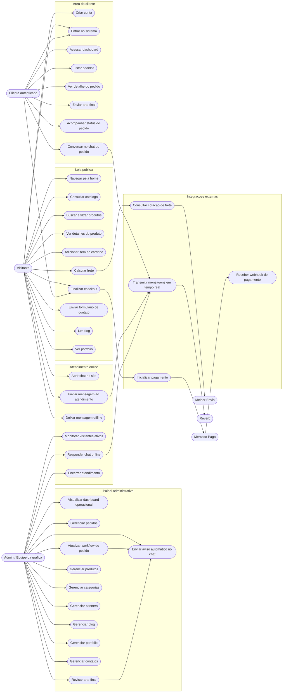

# Diagrama de Caso de Uso

Este diagrama mostra os principais atores do sistema e o que cada um pode fazer no e-commerce da grafica.



## Atores

- `Visitante`: pessoa que acessa o site sem necessariamente estar logada.
- `Cliente autenticado`: usuario cadastrado que compra e acompanha pedidos.
- `Admin / Equipe da grafica`: usuario interno que gerencia catalogo, pedidos, artes, atendimento e conteudo.
- `Mercado Pago`: gateway usado para pagamento quando configurado.
- `Melhor Envio`: servico usado para cotacao de frete quando configurado.
- `Reverb`: servico de mensagens em tempo real usado no chat.

## Casos de uso principais

- O visitante navega pelo catalogo, adiciona produtos ao carrinho, calcula frete e finaliza o checkout.
- O cliente acompanha pedidos, envia arte final e conversa com a equipe pelo chat do pedido.
- O admin revisa artes, atualiza o workflow do pedido e gerencia o catalogo.
- Quando o admin revisa uma arte ou altera o workflow, o sistema envia um aviso automatico no chat do pedido.
- O atendimento online permite acompanhar visitantes ativos e responder mensagens em tempo real.

## Fluxo de compra resumido

```text
Visitante/Cliente
-> consulta catalogo
-> adiciona produto ao carrinho
-> calcula frete
-> finaliza checkout
-> pedido e criado
-> cliente envia arte
-> admin revisa arte
-> admin atualiza workflow
-> cliente recebe avisos no chat do pedido
```
